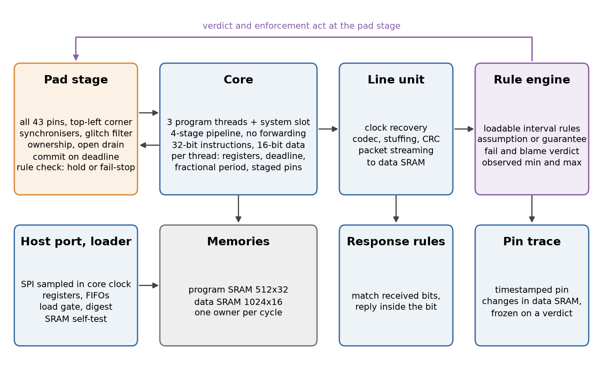
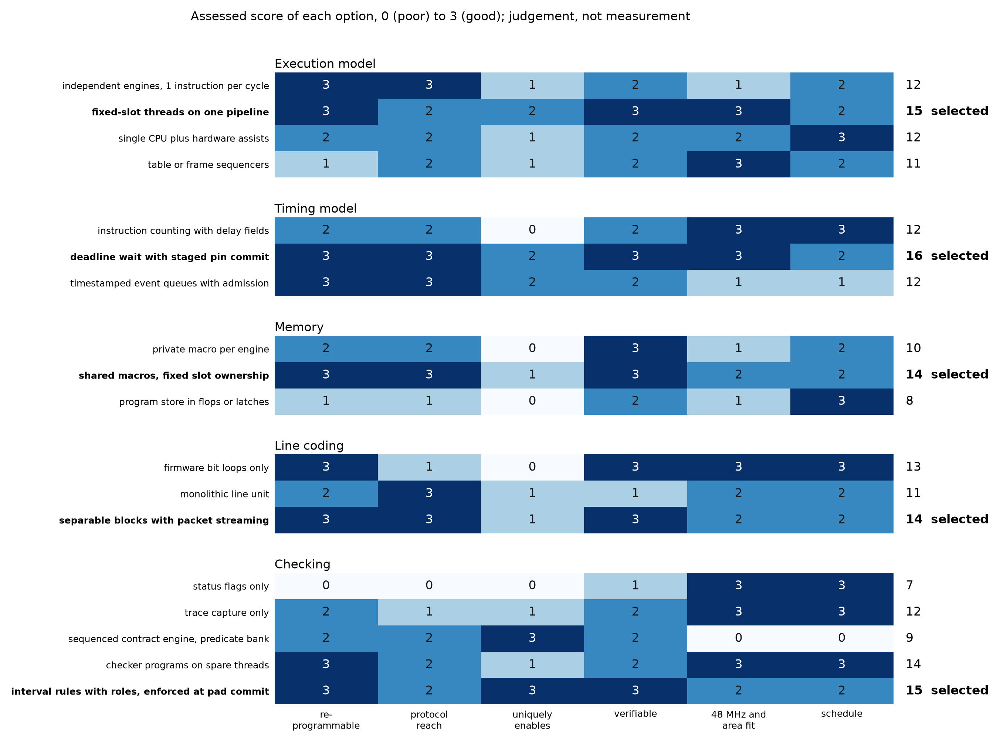
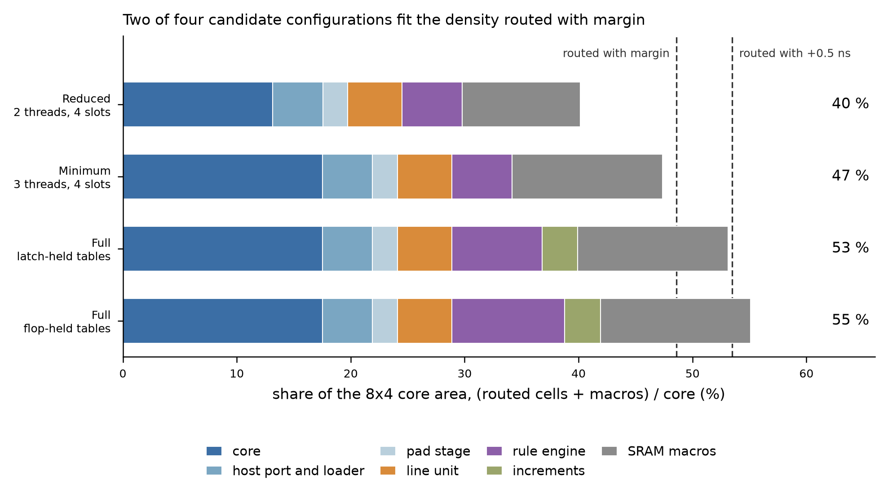

# Architecture selection for the 8x4 design

Status: RATIFIED 2026-11-13. The close calls R1 to R7 of section 9 were ratified as selected. Nothing below is inherited from the 6x4 design
(an earlier design by the same author, kept in a separate repository); each
dimension was decided on its own evidence. Section 9 lists the close calls on which a different choice
would be defensible.

Labels: **[fact]** = read from a file or tool output; **[measured]** = a block of that class
synthesised with the project flow (Yosys, SG13CMOS5L typical library, no wires) on 2026-11-11;
**[estimate]** = arithmetic or judgement on top of those.

## 0. Outcome

A fixed-slot multi-threaded core: three program threads and one system slot share a four-stage pipeline,
so each thread executes exactly one instruction every four clock cycles and no thread can disturb
another's timing. Timing is carried by data, not by instruction counts: each thread has a deadline and a
fractional period, and pin writes are staged and take effect on the deadline cycle. A packet-level line
unit handles line-coded protocols at rates the threads cannot reach, and response rules answer inside a
bit. Loadable interval rules, each marked as an assumption about the peer or a guarantee of the chip, are
checked at the pad stage; a guarantee violation is held back or stopped before it reaches the pad, and
every verdict freezes a pin trace.

## 1. Constraints and ground truth

- 8x4 tile, die 1724.16 x 710.64 um, core about 1,208k um^2 [fact, pending a real floorplan]. All 43 signal
  pins are on the top edge between x = 29.8 and 191.0 um [fact, template DEF]. One horizontal signal layer.
- Sign-off clock 48 MHz (20.83 ns), fixed. Protocols may run at a lower operating clock set by the host.
- Hardcaml v0.17.1, emitted as Verilog. Registers can be given a falling clock edge and the Verilog writer
  emits it; how Cyclesim treats such registers is untested; the library has no latch primitive [fact].
- The PDK revision pinned by the precheck ships 30 SRAM macros with LEF, GDS and liberty, including 512x32,
  1024x16 and 512x16 single-port [fact]. Only 256x16 has been through this project's flow.
- Utilisation is (routed standard cells + macros) / core. The 6x4 netlist family routed with margin up to
  48.6 %, with +0.5 ns at 53.5 %, and failed at about 68 %, all at 30 MHz [fact].
- Judging order: reprogrammability for protocols the chip was not designed for; protocols shown; what the
  architecture uniquely enables; design and verification quality. Stretch protocols: USB low speed,
  10BASE-T; more on-chip line coding, CRC and clock recovery counts for more; concurrency and both roles
  are a plus.
- 59 days to the internal target; no FPGA step.

## 2. Method

For each dimension: the options that exist, what was measured or reported for each, a 0-3 assessment on
six criteria, and the choice. The assessments are my judgement and are shown so they can be challenged;
the measurements are not judgement.

## 3. Decisions

| # | dimension | options considered | evidence | selected | reason |
|---|---|---|---|---|---|
| 1 | execution model | independent engines at one instruction per cycle; threads in fixed slots on one pipeline; one CPU with assists; table or frame sequencers | the 6x4 design's two engines with host port are 97.0k um^2 and its worst path at 30 MHz was 27.5 ns [fact]; one instruction per cycle puts SRAM access, decode and execute into one 20.83 ns cycle | threads in fixed slots, pipeline depth = round length | four cycles per instruction leave every stage shallow at 20.83 ns; no forwarding, stalls or hazards to verify; isolation is structural; three concurrent protocols for about the area of one data path |
| 2 | round | 4 threads; 3 threads + 1 system slot | memory ports serve one owner per cycle | 3 threads + system slot (thread count is a generator parameter) | loader, host, line unit and trace get guaranteed memory access without ever taking a thread's cycle, so the isolation theorem has no exceptions; a thread can be reloaded while the others run |
| 3 | instruction and data width | 16-, 20- or 32-bit instructions; 8- or 16-bit data | a 512x32 macro is 79.7k um^2 (416.64 x 191.34 um), a 1024x16 79.7k (236.8 x 336.46 um) [fact, PDK LEF] | 32-bit instructions, 16-bit data, 8 registers per thread | a thread executes at clk/4, so each instruction must do more: operation, pin action and deadline action in one word |
| 4 | timing model | instruction counting with delay fields; prescaled steps; deadline wait with staged pin commit; timestamped event queues with admission | a deadline-timer block with 388 flops 43.3k; a fractional rate generator alone 2.6-6.2k; a timed pin cell 6.3k; a timed event queue with 125 flops 22.8k [measured] | shared cycle timebase, per-thread deadline and 16.8 fixed-point period, one staged commit per thread | edges land on exact cycles whatever the instruction count or slot phase; rates are drift-free at any clock; a late arrival is detectable and can be made a fault; the cheapest of the exact-timing options |
| 5 | pins | crossbar; fixed pins with ownership | a crossbar is 24.3k um^2 [measured] | fixed pins, per-pin owner thread, per-pin open drain, pad readback | relocation is an assembler matter; ownership and open drain become structural properties |
| 6 | inputs | raw; 2-flop synchroniser; with glitch filter; both-edge sampling | a both-edge sampling front end is 2.5k um^2 with two latches [measured] | 2-flop synchroniser and programmable glitch filter on every input; both-edge sampling only on the line unit's receive pin, as an increment | no bypass of the synchroniser; both-edge sampling depends on the falling-edge register question |
| 7 | memory organisation | private macro per engine; shared macros with fixed slot ownership; program store in flops or latches | a flop-held program lane with 756 flops is 85.5k um^2 [measured], more than a 512x32 macro | one program SRAM (512x32) and one data SRAM (1024x16), each with exactly one owner per cycle | two macros instead of four or more; frame buffers and trace in SRAM; non-interference by construction |
| 8 | line coding and clock recovery | firmware bit loops; monolithic line unit; separable strobe-driven blocks | four separable blocks (clock recovery, codec, stuffer, CRC) 20.2k and 106 flops; monolithic units 40.9k and 52.9k [measured] | one packet-level line unit built from the separable blocks, streaming to and from the data SRAM; plus plain shift instructions for slow protocols | firmware at clk/4 cannot reach 12 Mbit/s; small blocks can each be proved; one unit because a second did not look affordable |
| 9 | reactions inside a bit | firmware only; response rules | two response rules 7.1k; a two-rule branch unit 6.3k [measured] | two response rules on recovered bits or pin-clock edges | acknowledge slots and handshakes need an answer within a few cycles; a constant reaction time is also easier to state and prove |
| 10 | on-chip checking | status flags; trace only; checker programs on spare threads; sequenced contract engine with a predicate bank; loadable interval rules | the sequenced engine of the 6x4 design is 192k um^2 with ROM tables and had a 27.5 ns worst path [fact]; an interval rule slot is budgeted at about 10.5k um^2 with flop-held tables [estimate] | loadable interval rules with assumption and guarantee roles, checked at the pad stage; checker programs on a thread for sequencing, feeding rule events | fully loadable, small, single-cycle, so it can sit in the pad path at 48 MHz; each rule is a three-state timed automaton that can be proved once for all firmware |
| 11 | enforcement | none; fail-stop; hold to minimum | literature on shields and synchronous enforcers | per rule: observe, hold the edge until the minimum is met, or fail-stop to a safe pattern | minimum-type timing violations by firmware are repaired or blocked before the pad; no added latency for compliant firmware |
| 12 | tracing | none; flop buffer; SRAM trace | a flop-held capture buffer with 2,134 flops is 160.6k um^2; an SRAM trace engine 11.9k [measured] | timestamped pin changes into the data SRAM through the system slot, frozen on a verdict | every fail or blame comes with the waveform; negligible area |
| 13 | host interface | SPI in its own clock domain; SPI sampled in the core clock; UART loader; parallel bus | pins are scarce (8 in, 8 out, 8 bidirectional) | SPI mode 0 target sampled in the core clock, loader with load gate and digest, four-word FIFOs per thread and direction | one clock domain for the whole chip; three pins in, one out |
| 14 | storage style | flops; latches opened by a gated pulse; SRAM-resident tables | a flop with enable multiplexer is 67.1 um^2 per bit, a latch cell 27.2-30.8 [fact, liberty] | flops, unless the skeleton gate shows the rule tables must move to latches | latches need an instantiated cell and new equivalence handling; decided from measured data |
| 15 | bridging | none; FIFO join between threads | small | FIFO join, as an increment | protocol bridge without the host |
| 16 | bring-up | none; SRAM self-test; loopback | small | SRAM march test in the loader and a pin loopback mode, as increments | a chip that loses its program on deselect should be able to prove its memory first |

## 4. The selected architecture

### 4.1 Round and memory ownership

| cycle mod 4 | pipeline | program SRAM port | data SRAM port |
|---|---|---|---|
| 0 | T0 fetch, T1 write-back, T2 execute | thread 0 | thread 2 |
| 1 | T0 decode, T1 fetch, T2 write-back | thread 1 | system slot |
| 2 | T0 execute, T1 decode, T2 fetch | thread 2 | thread 0 |
| 3 | T0 write-back, T1 execute, T2 decode | system slot | thread 1 |

A thread's branch is resolved before its next fetch, so there is no branch penalty and no forwarding. The
system slot carries, in fixed priority, line-unit streaming, trace writes, and host or loader access.

### 4.2 Timing

- `now`: 24-bit cycle counter. Per thread: deadline `t` (24 bits) and period `p` (16.8 fixed point).
- A thread stages a write {mask, value, enable} for the pins it owns. The pad stage applies it in the
  cycle `now` reaches `t`, independent of where the thread is in its round. An instruction can combine
  staging, waiting and advancing `t` by `p`.
- A thread that reaches its wait after the deadline has passed is late. Policy per thread: fault and release
  its pins, or commit immediately and set a flag.
- Fastest firmware-timed edge: one per round, 83 ns at 48 MHz [arithmetic]. Faster signalling uses the line
  unit.

### 4.3 Line unit and response rules

- Transmit: fractional bit clock, serializer from a data window, NRZ / NRZI / Manchester, stuffing
  (programmable run length and polarity), CRC of programmable width and polynomial, frame start and end
  patterns, single pin or differential pair.
- Receive: phase-accumulator clock recovery with hard sync and bounded resync, decode, destuff with error
  flag, sync-pattern hunt, CRC check, end-of-frame detection, word assembly into a data window with length
  and status.
- Owned by one thread at a time; its memory traffic uses the system slot.
- Response rules: match the last bits at a frame position (or anywhere), optionally conditioned on the CRC
  result, and drive up to 16 reply bits starting inside the matching bit or a set number of edges later.

### 4.4 Rules, enforcement, verdict

- A rule: start event, stop event, optional abort event, minimum, maximum, role (assumption or guarantee),
  policy (observe, hold to minimum, fail-stop), owner thread.
- Events: synchronised pad edges and levels; proposed commits on owned pins before they reach the pad;
  line-unit symbols (bit strobe, frame start and end, CRC result, stuffing error); codes emitted by a
  thread; deadline ticks.
- Assumption violated: blame, optionally releasing the owner's pins. Guarantee violated: fail; under
  hold-to-minimum the pad stage delays the offending edge until the minimum is met and records the repair;
  under fail-stop the owner faults and its pins take their configured safe pattern.
- An edge on a shared open-drain line counts as the peer's only if our driver was released before and
  after it.
- Verdict: first fail and first blame with rule number and cycle stamp, whether a blame preceded the fail,
  the digest of the loaded program and rule image; the trace freezes.
- Per rule, the smallest and largest observed interval are kept, so the host can read measured margins.

## 5. Claims the architecture is built to support

| # | claim | holds for |
|---|---|---|
| C1 | one clock of the chip equals one clock of the specification circuit | every state, every pin input, any memory contents |
| C2 | a thread's state and pins do not depend on what other threads or the system slot do | any programs, disjoint pin ownership |
| C3 | a staged pin write takes effect on its deadline cycle, or the thread faults; never late | any program |
| C4 | unowned pins are never driven; open-drain pins are never driven high; a faulted thread's pins take the safe pattern | any program |
| C5 | no pad edge violates the minimum of an enabled guarantee rule under hold or fail-stop policy | any program, any rule table |
| C6 | if the proposed edges satisfy every rule, pads equal proposals with no added latency | any program, any rule table |
| C7 | each rule slot equals its timed-automaton specification, including attribution | any rule table |
| C8 | a thread runs only from a loaded window, and the reported digest is the CRC of that window | any host sequence |
| C9 | final netlist equals RTL | the shipped netlist |

None of these is proved yet. Hard to verify and not covered by them: receive behaviour under real jitter
and frequency offset (a stated physical assumption), and pad timing outside the tile.

## 6. Protocol reach

| protocol | mechanism | operating clock | note |
|---|---|---|---|
| UART | firmware, fractional period | any | exact baud at any clock |
| SPI controller, modes 0-3 | firmware | any | up to about 6 MHz SCK [estimate] |
| SPI target | firmware; response rules for the first reply bit | any | reaction through synchroniser and round, about 10 cycles [estimate] |
| I2C controller and target, 100 and 400 kHz | firmware; response rule for acknowledge | any | |
| USB low speed | line unit, 32 samples per bit | 48 MHz | handshake by firmware or response rule |
| USB full speed | line unit, 4 samples per bit | 48 MHz | handshake needs a response rule (turnaround about 30 cycles) |
| CAN up to 1 Mbit/s | line unit with bounded resync and stuffing; acknowledge by response rule | any | arbitration needs transmit abort on readback mismatch (increment) |
| 10BASE-T | line unit, Manchester | 40 MHz | transmit at 2 cycles per half bit; receive needs both-edge sampling (increment); external line interface |
| 1-Wire, WS2812, JTAG, SWD, PS/2 and similar | firmware | any | |

## 7. Budget

| configuration | local synthesis | routed (x 1.33) | macros | utilisation |
|---|---|---|---|---|
| Reduced: 2 threads, 4 rule slots, 512x16 data | 270.6k | 359.9k | 125.0k | 40.1 % |
| Minimum: 3 threads, 4 rule slots | 310.3k | 412.7k | 159.4k | 47.4 % |
| Full, latch-held rule tables: 3 threads, 8 slots, all increments | 362.8k | 482.5k | 159.4k | 53.1 % |
| Full, flop-held rule tables: 3 threads, 8 slots, all increments | 380.7k | 506.3k | 159.4k | 55.1 % |

Basis [estimate unless marked]: state costs about 100 um^2 per bit including its logic (83-131 on four
measured blocks); a thread holds 397 bits; data path and pipeline 40k; host port and loader 40k;
pad stage 20k; line unit 43.2k (four measured blocks 20.2k plus transmit and streaming
control); a rule slot 10.5k with tables in flops or 8.2k with tables in latches;
response rules 7.1k, trace 11.9k, both-edge front end 2.5k [measured].
Numbers: [budget_candidates.csv](budget_candidates.csv).

The plan's feasibility note quoted about 56 % for the full design and 40-43 % reduced; this itemised
version gives 53-55 % and 40 %. All of it is to be replaced by the skeleton run. No configuration has been
through place-and-route, and none of the estimates covers 48 MHz timing.

## 8. Risks

1. Density. The full design sits at or beyond the point where the 6x4 netlist had +0.5 ns at 30 MHz.
   Levers, in order: latch-held rule tables, a 512x16 data SRAM (-2.8 points), fewer rule slots, two threads.
2. 48 MHz in the pad path. The rule check decides in the cycle before a commit; it must be computed one
   cycle ahead from registered values and proved equal to the direct definition.
3. Macro types. 512x32 and 1024x16 are untested in this flow; fallback is two 256x32 or several 256x16.
4. Receive performance at 4 samples per bit (USB full speed) depends on the jitter assumption.
5. Schedule. Specification, RTL and proofs for a new core, line unit and rule engine in eight weeks.

## 9. Close calls

Ratified as selected on 2026-11-13. Each can still be reduced at the skeleton gate if the routed numbers
require it (section 8, risk 1).

| # | choice made | alternative | what the alternative gains and costs |
|---|---|---|---|
| R1 | threads on one pipeline | two independent engines | full-rate instructions per engine and a simpler mental model; loses the third context, needs one-cycle fetch through SRAM at 48 MHz or branch delay handling |
| R2 | 3 threads + system slot | 4 threads, assists borrow the owner's slot | a fourth context; isolation statement gains exceptions |
| R3 | 32-bit instructions in 512x32 | 16-bit in 1024x16 | about twice the instruction count per macro; more instructions per pin edge at clk/4 |
| R4 | interval rules + checker threads | a sequenced contract language compiled to a checker thread plus rules | richer contracts later without hardware; more toolchain work |
| R5 | hold-to-minimum as well as fail-stop | fail-stop only | simpler proof and pad stage; loses timing repair, the most distinctive behaviour |
| R6 | one line unit | two | two line-coded protocols at once (for example both ends of a link on one chip); about +43k um^2 local, 4.7 points |
| R7 | data SRAM 1024x16 | 512x16 | 2.8 points of area; a full Ethernet frame no longer fits beside the trace |

## 10. Deliberately absent

Sub-cycle delay lines (outside timing analysis and proofs); a pin crossbar; per-pin event queues; an
on-chip program certificate checker; a second clock domain; any block that exists for one protocol only.

## 11. Held-out list

The held-out protocols are drawn by `tools/heldout_draw.py`, run by you and never by a design session: a list a
design session can see is not held out.

- Pool, fixed in the script before any draw: the 68 decoders of the sigrok catalogue (libsigrokdecode
  71f4514430, 132 decoder directories) that take raw logic as input, minus the 10 protocols already in
  section 6, minus 7 measurement utilities that define no protocol: 51 names. Nothing is removed
  for being hard or infeasible on this chip; a held-out protocol that cannot be done is reported as such.
- `seal` creates a secret salt and prints its commitment and a pulse time in the future. Both are committed.
- `draw`, after that time, takes the first NIST randomness-beacon pulse at or after it and selects the 8
  names with the smallest sha256(pulse : salt : name). It prints only the SHA-256 of the result file, which
  is committed before any specification is written.
- `verify`, at reveal, recomputes pool, pulse, draw and the three committed values from the revealed file.

The salt keeps the draw unknown to anyone who has only the public inputs; committing it before the pulse
exists prevents re-rolling. State on 2026-11-13: the pool is fixed (its hash is printed by `seal`: `4b8f7c6dfff3f970163fbe965d09a7a91a26ae98fe3c56ec3e3e4f5dcfb484f7`); seal and draw are not yet made. Tested on 2026-11-13 with a throwaway salt and a past pulse: seal, draw,
refusal to draw twice, verify, detection of an altered list, refusal before the pulse exists.

## 12. Hardcaml and downstream flags

- SRAM macros are black boxes with behavioural models in simulation; `bm_bist` variants bring extra pins and
  their own PDN geometry.
- Falling-edge registers (both-edge sampling) create half-cycle paths, and Cyclesim simulates them as
  rising-edge registers without an error (`probe/edges`, `log/ground_truth.md` section 5), so a block that
  uses them needs another verification route.
- Latches, if adopted, are instantiated library cells; simulation model, emission and equivalence must be
  shown in the ground-truth step first.
- All registers reset through `rst_n`; SRAM contents are undefined after power-up and deselection, so every
  window is gated by its load flag.
- Pad outputs stay registered; the enforcement multiplexer sits in front of the output register.
