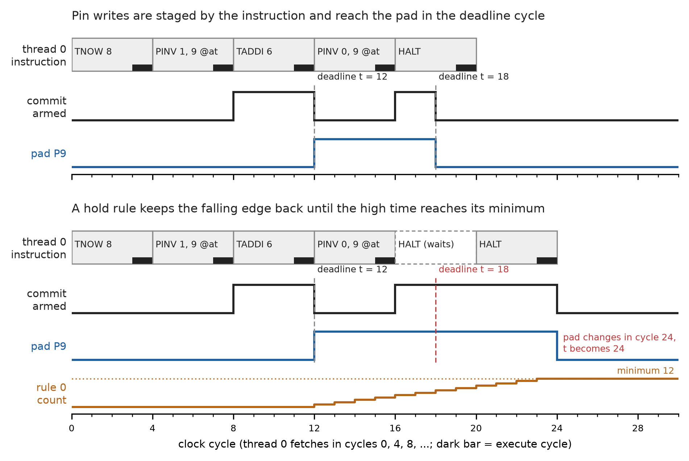

# Machine model: threads, time and pins

Version 1.1 of 2026-11-21: registered block boundaries (`doc/decisions/spec_v1_1.md`); version 1.0
frozen 2026-11-16 (`doc/decisions/spec_freeze.md`); changed only together with
`spec/model.ml` and `spec/circuit/`. Scope: the three program threads, their timing hardware, the pad stage, memory windows, faults.
The rule engine is in `rules.md`, the host port and loader in `host.md`, the trace in `trace.md`, the
line unit and the response rules in `line.md`. Instruction encodings are in `isa.md`, generated from `spec/isa.ml`.

Every statement below is implemented in `spec/model.ml`; the tests named in section 12 show the timing
statements on running programs.

**Visibility (v1.1).** Each thread is a block: it reads the other blocks' registers as they are at the
start of the cycle (`spec_v1_1.md`, V1). For a thread this means: the verdict bits 4 and 5 and the
repaired bit 6 of the status word (BST, WAITS, IOR) show verdicts and repairs recorded up to the
previous cycle; the line unit's ownership and configuration registers, and the rule registers read
by IOR, are those of the start of the cycle, so a write by another thread (IOW) or by the host is seen
from the next cycle. A thread's own timing and execute keep their order inside the cycle. The pad
registers merge the commits of all threads on their own pins, the line unit's override and the safe
pattern in the same cycle, as in v1.0 (V2).

## 1. Conventions

- One clock. All state changes at its rising edge. Cycle n is the interval between the edge that begins it
  and the next edge; "during cycle n" refers to register values in that interval.
- `now` is a 32-bit counter holding the cycle number modulo 2^32; it is 0 in the first cycle after reset.
- Registers are 16 bits, r0 to r7 per thread. There is no flags register and no register that reads as 0.
- Reset: all threads idle, pad values 0, all bidirectional pins released, `now` = 0. Memory contents are
  not reset.

## 2. Round

Thread T (0, 1, 2) fetches only in cycles with `now mod 4 = T`. The fourth cycle belongs to the system
slot (host, loader, line unit, trace). An instruction fetched in cycle c

| cycle | what happens |
|---|---|
| c | the word at `pbase + pc` is read from the program memory |
| c+2 | data memory access of LD, LDX, ST, STX; a store is in the memory from cycle c+3 |
| c+3 | execute: everything else is computed from the state of this cycle |
| c+4 | the effects are visible; this cycle is called the instruction's effect cycle e |

A thread has at most one instruction in flight; its next fetch is in cycle c+4. Each memory port
therefore has one owner per cycle: program memory T0, T1, T2, system in cycles 0 to 3 of the round; data
memory T2, system, T0, T1.

An instruction that has to wait (sections 5 and 8) has no effect at all and is fetched again in cycle
c+4, so it retries every round.

## 3. Pins

| pins | pad | a thread can | reads as |
|---|---|---|---|
| P0..P7 | `uio[0..7]` | drive, release | synchronised pad input |
| P8..P15 | `uo[0..7]` | drive (P8 is the host port's output and cannot be owned) | the output value |
| P16..P23 | `ui[0..7]` | read (`ui[0..2]` are also the host port's inputs) | synchronised pad input |

Pin assignment to the host port is provisional until the host document and the floorplan.

- **Pad registers.** `value[15:0]` for P0..P15 and `dir[7:0]` for P0..P7.
  `uo = value[15:8]`; for a push-pull pin `uio_out = value`, `uio_oe = dir`; for a pin in open-drain mode
  `uio_out = 0` and `uio_oe = dir and not value`, so it is never driven high.
- **Owner.** Each of P0..P15 has an owner: thread 0, 1, 2, or none. A pin with no thread as owner holds
  the safe pattern (`safe_val`, `safe_dir`), which the host sets. Owner, open-drain mode and safe pattern
  are host configuration.
- **Inputs.** `x(n)` is the pad level sampled by the first synchroniser stage at the edge that begins
  cycle n. With filter length F (0 to 3, per pin), the synchronised value `s` changes to a new level in
  cycle n if `x(n-1-F) .. x(n-1)` all have that level. With F = 0, `s(n) = x(n-1)`. There is no path from
  a pad to a thread that bypasses the synchroniser.
- **Staging.** Pin instructions do not change the pads. They write the thread's staged set: a value and a
  mask for P0..P15, and a value and a mask for the output enables of P0..P7. Staging a pin the thread
  does not own is the fault PINOWN.
- **Commit.** A commit copies the staged values of the masked pins the thread owns into the pad
  registers, clears the staged set, and loads the thread's capture register `cap` with all 24 pin values
  as read in the cycle before. A commit with an empty staged set is a pure capture.

## 4. Timing modes

Bits [25:24] of every timed instruction select what follows its own effect:

| tm | name | meaning |
|---|---|---|
| 0 | | nothing |
| 1 | `@now` | commit as soon as possible: the pads change in cycle e + 1 |
| 2 | `@at` | arm a commit for the deadline t: the pads change in cycle t |
| 3 | `@adv` | as `@at`, and when the commit happens t := t + p |

## 5. Deadlines

- Each thread has a deadline `t` (32 bits of cycles and 8 fraction bits) and a period `p` (24 bits of
  cycles and 8 fraction bits). Only the integer part of t is compared with `now`; the fraction makes
  average rates exact: after k steps of `@adv` the deadline is `t0 + floor(k * p)`.
- **Arming** in effect cycle e is on time iff `t - e >= 1`, taken as a signed 32-bit difference. The
  thread then continues with its next instructions while the commit is armed.
- **Late.** If `t - e < 1`: with the strict policy the thread faults LATE and the instruction has no
  effect; with the lenient policy the commit is carried out as soon as possible (the pads change in cycle
  e + 1) and the sticky LATE status bit is set. The policy is host configuration per thread.
- **One path for every commit.** Instructions never change the pads themselves. `@now`, `@at`, `@adv`,
  the commit of an event wait and the safe pattern after a fault all leave a pending commit, which the
  timing hardware carries out. A pending commit is due from cycle t - 1 (deadline commits) or at once
  (the others), and it fires in the first cycle in which it is due and the rule engine does not block it
  (`rules.md`, section 7).
- **Firing** in cycle n: the pads have the new values during cycle n + 1, `cap` holds the pins as read
  in cycle n, and the commit is no longer pending. Without a block, a deadline commit fires in cycle
  t - 1, so the pads change in cycle t. If it fires in any other cycle, because it was late or blocked,
  t is set to n + 1, the cycle in which the pads change; `@adv` then adds p.
- **Order within a cycle.** Timing events are applied first; an instruction in its execute cycle acts on
  the result. An instruction whose execute cycle is the cycle in which the armed commit fires is
  therefore not kept waiting and sees the new capture.
- **Instructions that wait while a commit is armed:** every instruction with tm not 0; every instruction
  that stages a pin, reads `cap`, or writes t or p; WAITP, WAITS, HALT. The column in `isa.md` lists
  them. Everything else (arithmetic, memory, branches on registers or live pins, mailboxes) runs while a
  commit is armed, so the time before a deadline is available for computing the next value.
- **Slack.** At every arming, and every event wait with a deadline, `t - e` is recorded if it is smaller
  than the recorded minimum (16 bits, saturating). The minimum is readable by the thread (TGET) and the
  host. A value of 1 means the program met its deadline with nothing to spare.

Consequences, each shown by a test (section 12):

1. A thread can commit once per round, i.e. every 4 cycles, for any alignment of its deadlines to its
   slot.
2. An edge produced by `@at` or `@adv` is in cycle t exactly, whatever the instruction count before it;
   otherwise the thread has faulted or, under the lenient policy, the LATE bit is set.

### Figure: one deadline commit, cycle by cycle

Thread 0 runs `TNOW 8`, `PINV 1, 9 @at`, `TADDI 6`, `PINV 0, 9 @at`, `HALT`. Top: no rule. The first
write is armed when its instruction has executed (cycle 8) and the pad shows it in cycle t = 12; the
second in cycle t = 18. Bottom: rule 0 is a guarantee with policy hold, minimum 12 cycles from the commit
that raises P9 to the commit that lowers it. The second commit is due for cycle 18, is kept back while
the count is below 12, and reaches the pad in cycle 24; t becomes 24, and `HALT`, which waits for an
armed commit, runs a round later. The values are the reference model's (`spec/contract_trace.ml`,
`fig/timing_contract.csv`, checked by `dune test`); `tools/plot_timing_contract.py` draws them.

## 6. Event waits

WAITP (a pin: low, high, rising, falling) and WAITS (a status bit equal to a value) put the thread to
sleep from their effect cycle e. In every cycle n >= e the condition is evaluated on the values read in
cycle n; an edge compares cycle n with cycle n - 1.

- **Event** first seen in cycle n: if `cm` = 1 the staged set becomes a pending commit that is due at
  once (otherwise it is kept and nothing is pending). When it fires, in cycle n unless a rule blocks it,
  or immediately if `cm` = 0: `cap` holds the pins as read in that cycle; status bit EV := 1; if `re` = 1
  then t := that cycle + 1 with fraction 0; if `adv` = 1 then t := t + p; the thread runs again from the
  next cycle.
- **Deadline**, only if `to` = 1, in cycle t - 1 without an event up to that cycle: the staged set is
  committed as a deadline commit, and EV := 0. Lateness at e is handled as in section 5; under the
  lenient policy the timeout is due in cycle e.
- With `to` = 0 and a condition that never holds the thread sleeps until the host stops it.

From the pad to the pad, a reaction with `cm` = 1 is constant: an input level first sampled at the edge
that begins cycle k (F = 0) changes the output register at the edge that begins cycle k + 2.

After an event the thread needs up to 4 cycles to reach its slot and 4 per instruction. A deadline set by
one further instruction after the wait (for example TADDI) is on time for every alignment if it is at
least 12 cycles after the cycle in which the event commit became visible; with `adv` in the wait itself,
8 cycles.

## 7. Memory windows

- Program: `pc` is relative to the thread's window. Fetching with `pc >= psize` is the fault PCBOUND; the
  word read is `prog[(pbase + pc) mod 512]`. Branch targets are 9 bits; JR to a value `>= psize` faults at
  the JR.
- Data: the effective address (10-bit constant, or register plus 10-bit constant, modulo 2^16) is
  relative to the window; `>= dsize` is the fault DBOUND and nothing is read or written.
- Windows are host configuration. The isolation claim assumes the host gives threads disjoint windows and
  disjoint pin sets.
- ST and STX are not timed, so a store is never repeated.

## 8. Mailboxes, status, I/O registers

- Channel 0 of PULL and PUSH is the thread's mailbox pair with the host: host to thread, thread to host,
  each a queue of depth D (generator parameter, 1 in the area budget). PULL waits while its queue is
  empty, PUSH while its queue is full. Channels 1 to 3 are reserved for thread-to-thread bridges; without
  them an access waits for ever.
- Status bits (BST, WAITS, I/O register 0): 0 EV, 1 mailbox from host not empty, 2 mailbox to host not
  full, 3 LATE (sticky), 4 FAIL recorded, 5 BLAME recorded, 6 a rule was repaired (`rules.md`). Bits 7 to
  13 belong to the line unit and read 0 for every thread but its owner (`line.md`, section 2). Bits 14
  and 15 read 0.
- I/O register 0: read gives the status bits; writing 1 to bit 0 or bit 3 clears EV or LATE. Registers
  0x20 and up are the rule measurements (`rules.md`, section 8). Registers 0x40 to 0x6F are the line
  unit's, for its owner only (`line.md`, section 3). Any other address is the fault IOPERM.

## 9. Faults

| fault | cause |
|---|---|
| ILLEGAL | a word that is not a legal instruction |
| PCBOUND | fetch or JR outside the program window |
| DBOUND | data address outside the data window |
| PINOWN | staging a pin of another owner |
| LATE | deadline not ahead, strict policy |
| IOPERM | I/O register not accessible |
| TRAP | the TRAP instruction, with its code |
| RULE | fail-stop by the rule engine, with the rule number |

A faulting instruction has no other effect. The thread stops with `pc` at that instruction. Whatever
was staged or pending is replaced by the safe pattern of all its pins as a pending commit, due at once:
the pins hold the safe pattern from cycle e + 1, or later if a rule blocks that commit. (For a RULE
fault found by the automaton, e is the cycle after the event that violated the rule: `rules.md`.) HALT stops the
thread and leaves its pins as they are.

## 10. Instruction semantics

The table in `isa.md` gives one line per instruction; where it is not exhaustive, `spec/model.ml`
(function `execute`) is the definition. Points that are easy to get wrong:

- `now` in TNOW and TGET is the effect cycle e of that instruction.
- ALUI and BRI zero-extend their constant. `slt`, `lt`, `ge` compare as signed 16-bit numbers.
- Shift amounts are 0 to 15; SHV uses `rb[3:0]`.
- CRC, not reflected: for each data bit d (bit 7 first in byte mode), `fb = rd[15] xor d`, `rd := rd << 1`,
  then `rd := rd xor rb` if fb. Reflected: `fb = rd[0] xor d` (bit 0 first), `rd := rd >> 1`, then the same.
  Polynomials narrower than 16 bits are left-aligned in the non-reflected form.
- JAL stores `pc + 1`, a window-relative address.
- DJNZ decrements modulo 2^16 and branches if the result is not 0.

## 11. Hooks for blocks not yet specified

- EMIT produces (thread, code) in its execute cycle for the rule engine, and for the trace.
- While the line unit sends, it decides the value and direction of its pins; a thread's commit to those
  pins is dropped in those cycles (`line.md`, section 4).
- System slot of the data memory: line unit, then host, then trace.

## 12. Tests

`dune test` runs `spec/test`:

| test | shows |
|---|---|
| decode is total and canonical | every word is ILLEGAL or decodes to one instruction that encodes back to it |
| CRC step against published check values | CRC-16/CCITT-FALSE, CRC-16/ARC, CRC-8 |
| UART frame | bit boundaries at `t0 + floor(k * 416.668)` |
| one edge every 4 cycles | section 5, consequence 1, three threads, five alignments |
| event wait | constant 2-cycle reaction; 12-cycle rule of section 6, and the fault at 11 |
| event wait with adv | the 8-cycle rule of section 6, and the fault at 7 |
| a deadline that has passed | strict and lenient policy |
| faults leave the pins in the safe pattern | section 9 |
| isolation | thread 0's trace is identical with and without two running neighbours |
| host mailbox round trip | PULL, ST, LD, PUSH |
| SPI controller | mode 0 byte exchange with a modelled target at 12 cycles per bit; LATE at 10 |

The rule engine's tests are listed in `rules.md`. These are examples, not proofs. The claims of the architecture document are proved on the RTL against a
circuit form of this model in a later step.

## 13. State

| per thread | bits |
|---|---|
| registers | 128 |
| pc | 10 |
| deadline t, period p | 40 + 32 |
| pending commit: armed, due, adv, deadline | 4 |
| staged set | 48 |
| capture | 24 |
| state, fault code and argument | 15 |
| EV, LATE | 2 |
| slack minimum | 16 |
| event-wait condition and phase | 14 |
| windows, late policy | 41 |
| mailboxes (D = 1) | 34 |
| total | 408 |

Shared: `now` 32; pad registers 24; pin configuration (owner, open drain, safe pattern, filter length)
108; synchronisers, filter counters and previous values 88. Core state: 3 x 408 + 252 = 1,476 bits, not
counting pipeline registers. Rule engine: 122 bits per rule and 131 shared (`rules.md`, section 9). Host
port and loader: about 313 bits (`host.md`, section 5). Trace: about 140 bits (`trace.md`, section 5).

## 14. Decisions taken in this document

Listed with the other decisions in `doc/decisions/spec_freeze.md`.

| # | decision | alternative and its cost |
|---|---|---|
| D1 | a commit is armed and the thread keeps running | sleeping until the deadline is simpler to explain but limits a thread to one edge per two rounds |
| D2 | every instruction carries a timing mode | separate wait instructions: one more instruction, 4 cycles, per timed action |
| D3 | 32-bit time, 8 fraction bits | 24-bit time saves 8 bits per comparator but wraps after 0.35 s at 48 MHz |
| D4 | compare-and-branch, no flags | flags add state that every proof about a thread has to carry |
| D5 | no toggle, no post-increment, no hardware loop | each would save an instruction in some loops; a serial bit costs 2 instructions (8 cycles) |
| D6 | all program and data addresses relative to a window | absolute addresses make a loaded program position-dependent |
| D7 | non-zero unused bits are ILLEGAL | ignoring them is slightly smaller but gives one instruction many encodings |
| D8 | mailbox depth is a generator parameter | fixed depth 4 costs about 300 more flip-flops |
| D9 | CRC as a register-to-register step of 1 or 8 bits | a per-thread CRC register adds state; a 16-bit step is deeper logic |
| D10 | a deadline commit that fires late, or is held by a rule, re-anchors t to the actual pad change | keeping t would make every later deadline late as well |
| D11 | every commit goes through the timing hardware, so `@now` changes the pads one cycle after the effect cycle | committing inside the instruction saves that cycle but puts the rule check into the execute stage and gives the pads a second writer |

## 15. Open points

1. Whether the "timing events first" order, which puts the fire decision in front of the execute stage,
   meets 48 MHz with the rule engine's blocking decision in that path (`rules.md`, open point 2).
2. Status bits 14 and 15 are unused.
3. Firmware rates quoted in the architecture document were estimates. On the model, a serial bit takes
   two instructions, 8 cycles (6 Mbit/s at 48 MHz), and an SPI controller bit three instructions, 12
   cycles (4 MHz); the SPI test exchanges a byte each way at that rate and faults at 10 cycles.
