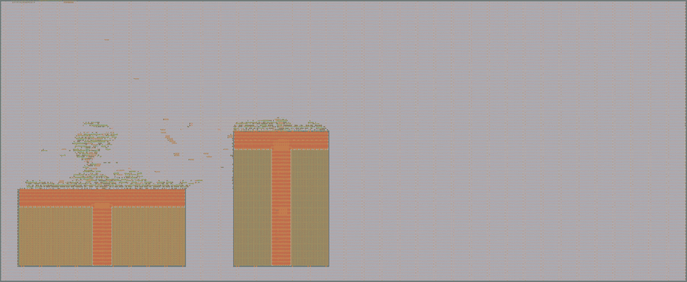

# Macro probe

Branch `probe-macros`. Question: do the two SRAM macro types of the architecture, 512x32 for programs and
1024x16 for data, go through this flow on the 8x4 tile at 20.83 ns (ground truth item O1)? Only the
256x16 type has been through it before, on another design.

## 1. The probe design

`probe/macros/probe_macros.ml`, emitted to `src/probe_macros.v`: both macros, every macro pin driven from
a register, every output captured by a register, a 72-bit shift register on `ui_in` to set up one access,
a byte selector on `uo_out`. 449 cells, 10.3k um^2 of logic by local synthesis. `test/test.py` writes one
word to each macro and reads both back; it passes on the RTL with the PDK's behavioural models
(`test/models`, copies from the pinned PDK), and the same test runs on the gate-level netlist in CI.

## 2. Power: how the macros get it

The tile's power grid is vertical Metal4 stripes only. The macros take power on vertical Metal4 columns,
2.81 um wide: VDD! and VSS! alternating at 5.62 um, VDD! below a horizontal break at y = 38.8 to 45.5 um
and VDDARRAY! above it on the same columns. The two bit-cell halves of a macro have the same column pitch;
the band between them is irregular.

The method, taken over from the earlier design where it passed sign-off for the 256x16 type:

1. Stripe pitch 44.96 um (four column pitches), spacing 3.52, width 2.1, offset 6.15.
2. A macro x position at which stripes fall inside columns of the same polarity.
3. `PDN_OBSTRUCTIONS` for the stripes over the macro that do not.
4. The step `Tile.MacroColumnStripes` (`librelane_plugin_tile_pdn.py`, `flow/pdn`), after the PDN is
   generated, makes each aligned stripe one full-height stripe across the macro, and fails if a power
   shape over a macro is outside a same-polarity column, touches the other polarity, leaves a supply pin
   unconnected, or a power pin breaks the Tiny Tapeout full-height rule.

Facts from `flow/pdn/plan_macros.py` on the LEFs of the pinned PDK:

| macro | size (um) | aligned VPWR + VGND pairs | where |
|---|---|---|---|
| 512x32 | 416.64 x 191.34 | 8 | x = 48.0 + 134.88 k (10 positions on the tile); 4 pairs at 328 other positions |
| 1024x16 | 236.80 x 336.46 | 4 | the same x positions; 2 pairs at 373 others |

Placement in the probe: program macro at (48.0, 41.58), data macro at (587.52, 41.58), both in orientation
FS so that their signal pins face up, towards the logic. Six obstructions remove 8 of the 76 stripes. On
the stripe model the planned result has no violation of the property for either macro.

The full-height VPWR stripes cross the break between VDD! and VDDARRAY!. `flow/pdn/check_sram_bar_gds.py`
on the macro GDS of the pinned PDK: under all 12 VPWR footprints (8 and 4) the break has no Metal4 and no
Via3; the nearest Metal4 is 2.82 um away.

## 3. Timing data from the liberty files

Slow corner (1.08 V, 125 C), largest table values, read by a simple parser and to be replaced by the
flow's timing report:

| macro | clock to data out | address setup | data-in setup |
|---|---|---|---|
| 512x32 | 6.7 ns | 1.4 ns | 1.1 ns |
| 1024x16 | 7.4 ns | 1.4 ns | 0.9 ns |

At 20.83 ns this leaves about 13 ns after a read for logic in the same cycle. The data-out pins have a
maximum load of 0.064 pF.

## 4. Settings and decisions for the run

- Magic DRC stays on. Its deck has no exceptions for the inside of the IHP SRAM (on the earlier design
  it reported 7,817 errors inside a 64x16 macro), so `ERROR_ON_MAGIC_DRC` is 0: the total is counted
  and reported without stopping the flow, and a separate step stops the flow on any violation outside
  the macros (section 5.2). The precheck runs the PDK's KLayout deck on the full layout.
- `ERROR_ON_ILLEGAL_OVERLAPS` 0 (stripes over the macro's obstruction at the break) and
  `ERROR_ON_PDN_VIOLATIONS` 0 (the check that runs before the stripes are extended), as on the earlier
  design.
- Macro halo 2.0 / 0.48 um, post-route design repair on with a 30 % capacitance margin, as on the
  earlier design. These are starting values, not tuned for 48 MHz.

## 5. Results

Run 43581583299 on commit c4ab62f (2026-11-14): all four jobs passed (gds 77.5 min, precheck 4.5 min,
gate-level test, viewer). Everything below is read from that run's logs and report files.

Program macro at the left, data macro to its right, the probe logic above their pin edges; the tile
pins are at the top left.

### 5.1 Power

- `Tile.MacroColumnStripes` ran under LibreLane 3.1.0.dev4: 16 stripes extended over `core.u_prog`
  (8 power, 8 ground), 8 over `core.u_data` (4 and 4), 0 violations of the column and polarity
  checks, 69 Metal4 power pin boxes with 0 violations of the full-height pin rule.
- `flow/pdn/check_macro_stripes_def.py` on the final DEF and exported LEF, run separately from the
  step: `VDD!`, `VDDARRAY!` and `VSS!` fed on both macros, 0 violations.
- The power-grid check after routing reports all shapes on VPWR and on VGND connected. The 160
  "unconnected shape" warnings and the 12,332 power grid violations in the log come from the check
  that runs before the stripes are extended.
- Worst IR drop 0.21 mV on VPWR and 0.20 mV on VGND (typical corner, 0.9 mW total; the probe hardly
  switches, so this says the grid is connected, not that it is sized).
- LVS: circuits match uniquely, 0 errors. Antenna: 0 violating nets.
- Magic extraction reports 25 illegal overlaps, all "obsm4 and metal4", all inside the two macros
  at the heights of the obstruction between the `VDD!` and `VDDARRAY!` pin rectangles (20 on the
  program macro, 5 on the data macro). That is where the extended stripes cross the bar that
  section 2 shows to be free of metal in the GDS.

### 5.2 Design rules

- Precheck, PDK KLayout deck (333 rules, the same set as on the empty tile; the SRAM marker layer is
  seen with 4 polygons): 0 violations. Pin, boundary, layer and cell-name checks pass.
- Detailed routing: 0 violations.
- Magic DRC: 230,585 violation boxes (Magic notes that its count "should be divided by 3 or 4"),
  **all of them completely inside the placed outline of one of the two macros, none outside and none
  crossing a macro edge**. The step took 49 min 52 s.

| Magic rule | in program macro | in data macro | outside |
|---|---|---|---|
| Metal2 minimum area < 5760 (M2.d) | 61,440 | 61,440 | 0 |
| Can't overlap those layers | 51,752 | 51,662 | 0 |
| Extension of tie diffusion beyond tie contact < 6.0um (LU.d, LU.d1) | 1,170 | 1,122 | 0 |
| This layer can't abut or partially overlap between subcells | 696 | 448 | 0 |
| N-Diffusion spacing to N-well in SRAM < 54 (NW.d exception) | 228 | 454 | 0 |
| N-diffusion overlap of contact in SRAM < 4 (Cnt.c SRAM exception) | 44 | 81 | 0 |
| N-diffusion overlap of N-diffusion contact < 14 (Cnt.c) | 21 | 27 | 0 |

Since the total can no longer gate the flow, the step `Tile.MagicDRCOutsideMacros`
(`librelane_plugin_tile_drc.py`, `flow/drc/magic_outside_macros.py`) now runs after Magic DRC and
stops the flow if any violation is not completely inside a macro outline. On this run's report it
counts 230,585 inside and 0 outside; with one violation added in open area it fails. Its self-test
(`flow/drc/test_magic_outside_macros.py`) covers a box crossing a macro edge and a rotated macro.
What Magic no longer checks is the inside of the macros, including the stripes drawn over them;
those are covered by the KLayout deck, LVS, and the two stripe checks.

### 5.3 Timing at 20.83 ns

Worst setup slack 12.27 ns (slow corner), worst hold slack 0.13 ns (fast corner), no setup or hold
violations in any corner. Slow corner, 1.08 V, 125 C:

| | program 512x32 | data 1024x16 |
|---|---|---|
| clock to data out, as timed in the path | 6.79 ns | 7.55 ns |
| worst slack, macro output to a register through one gate | 13.33 ns | 12.27 ns |
| worst slack, register to a macro input | 16.20 ns | 16.21 ns |
| setup time used at that input | 0.36 ns | 0.36 ns |
| worst hold slack at a macro input | 0.71 ns | 0.80 ns |
| hold time used at that input | 0.85 ns | 0.37 ns |

- About 12 ns remain after a read for logic and routing in the same cycle.
- The flow inserted 253 hold buffers for 163 endpoints. The worst path into the program macro passes
  three delay cells and arrives at 4.7 ns through four small gates. The real design should budget for
  hold cells in front of the macro inputs and not count on a short path into a macro.
- **Open: 4 maximum-capacitance violations in every corner, all on data-macro outputs**
  (`A_DOUT[8]` 0.099 pF, `A_DOUT[0]` 0.073, `A_DOUT[1]` 0.072, `A_DOUT[2]` 0.071 against the 0.064 pF
  limit). Post-route repair saw 3 of them and did not clear them. The checker only warns. To fix in
  the skeleton: a buffer or the capture register placed at each data-out pin. No slew violations.

### 5.4 Function

The cocotb test writes and reads one word per macro. It passes on RTL and on the gate-level netlist
of this run with the PDK's functional SRAM models (1 test, 0 failures). That shows the pin hookup
(enables, write, address, data, `A_DLY` high, BIST pins low), not the macro's timing.

### 5.5 Conclusion for ground-truth item O1

Both macros go through the flow and the precheck on 8x4 at 20.83 ns with the settings of section 4.
Carried forward: the maximum-capacitance violations above, Magic DRC as a gate only outside the
macros, a gds job of about 78 minutes with Magic DRC on, and macro positions that are a first
choice (the macros sit about 480 um below the tile pins).
