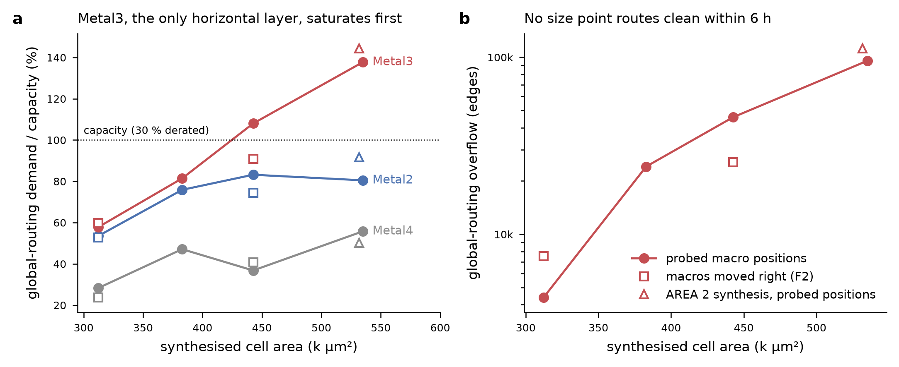

# Skeleton gate G1 (plan step 4), status 2026-11-20 (updated 2026-11-21: routing fixed on the 312k point)

Gate G1: detailed routing clean and slow-corner setup slack at least +1.0 ns at 20.83 ns.
**Result so far: G1 fails.** No skeleton configuration has routed. The step is open; the options are
in section 5.

## 1. Test load

Branch `probe-skeleton` (`probe/skeleton/README.md`): the specification circuit of commit 64916bc
with one execute stage for all threads and one host register read multiplexer, both SRAM macros at
the probed positions (program 48.00, data 587.52, y 41.58, FS), the chip's pins. Local mapping
524,159 um^2 [measured, typical liberty]. Size points remove blocks (`SKEL_CUT`). All runs on
GitHub-hosted runners, 6 h job limit; a cancelled job uploads no artifacts, so its evidence is the
job log. Every run: `log/skeleton_gate_runs.csv`.

## 2. Flow findings [measured]

1. With `SYNTH_STRATEGY` "DELAY 4", ABC's buffering stage maps nets to I/O pad cells
   (`IOPadOut4mA` x22, `IOPadOut16mA` x3: 360,000 um^2): synthesis reads the `sg13cmos5l_io`
   liberty and the PDK's `synth_exclude.cells` does not list pads. Excluding them
   (`EXTRA_EXCLUDED_CELLS`) still leaves 1,037,014 um^2 (32,808 `buf_1`). "AREA 0" gives 534,979
   and "AREA 2" 531,679 um^2. Every later run uses "AREA 0" with the pads excluded.
2. Yosys FSM extraction did not finish on the specification circuit in 38 minutes; with
   `(* fsm_encoding = "none" *)` on every register it maps in 49 s with FSM passes on.
3. The synchronous clear ties `RESET_B` of every flop high through its own `tiehi`
   (3,426 cells, 25k um^2) besides the clear gate on D.
4. Signal routing is Metal2 to Metal4 (`RT_MAX_LAYER` Metal4, TopMetal1 reserved for the chip
   grid); Metal3 is the only horizontal layer; `GRT_ADJUSTMENT` 0.3.
5. A macro placement with a 33 um gap between macros (x 992.16 / 1261.92) fails the stripe check
   C4: the PDN generator leaves Metal4 power pin boxes that reach neither die edge.

## 3. Routing results

| netlist (synthesis) | floorplan | util. | Metal3 use | GRT overflow | DRT violations (iteration) |
|---|---|---|---|---|---|
| 534,979 | probed | 60.4 % | 137.8 % | 95,528 | global routing not converged in 6 h |
| 442,618 (no rule engine) | probed | 49.3 % | 108.0 % | 45,847 | 134,696 (2) |
| 442,618 | data 722.40, program 1127.04 | 49.3 % | 90.9 % | 25,584 | 72,652 (3) |
| 442,618 | probed, Metal4 obstruction | 49.3 % | 107.5 % | 44,181 | 205,743 (2) |
| 382,856 (also no line unit) | probed | 42.7 % | 81.4 % | 24,140 | 30,786 (7) |
| 312,299 (also no host read, trace) | probed | 34.9 % | 57.8 % | 4,400 | 3,992 (32) |
| 312,299 | data 722.40, program 1127.04 | 34.9 % | 59.8 % | 7,546 | 35,856 (6) |
| 312,299 | probed, 3 iterations | 34.9 % | | | 15,613 (3), with reports |
| 312,299 | probed, Metal4 obstruction, 3 iterations | 34.9 % | | | 11,004 (3), with reports |

## 4. Where the 312k point fails [measured, run 44586255761 and 44621957176]

- 3,888 Metal4 violations, nearly all inside the data macro outline (x 587.5-824.3, y 41.6-378.0);
  1,953 are shorts with VPWR or VGND. Nets whose cells lie on both sides of the macro cross it
  on Metal4 with wrong-way jogs (example `_03475_`: x 587.0 to 616.8 at y 92.8). A Metal4
  `ROUTING_OBSTRUCTIONS` over the macro outline was created (step log) and the crossings remained.
- 11,700 Metal2/Metal3 violations at y 300-500 along and above the data macro's pin edge and
  around x 1000.
- For comparison (earlier 6x4 work, two macros, 30 MHz): 43.5 % and 46.9 % routed with 0 DRC,
  56.7 % did not. The skeleton fails at 34.9 %: the failure is placement across the 336 um tall
  data macro, not only size [inference].

## 5. Options (decided 2026-11-20: A first, then C, scope kept)

The minimum configuration of the specification does not route on 8x4 in this floorplan, and its
size alone (535k) is above every routed point.

| option | changes a ratified item | expected effect | cost |
|---|---|---|---|
| A. Floorplan: confine logic to one side of the data macro (placement region or a narrow macro column on one edge), keep 1024x16 | no | removes the macro crossings; does not fix the 535k size | 1-2 runs, 6 h each |
| B. Data memory 1024x16 replaced by 512x16 (191 um tall) or 256x16 | yes (memory size, R-item) | smaller crossing obstacle, 34-51k um^2 freed | spec change for trace and line streaming depth |
| C. Chip RTL written for area (one register-file read path per port, one decoder, shared timing compare where legal), size measured before it is hardened | no | unknown until written; the skeleton's execute alone is about 86k um^2 of logic | RTL step first, gate after |
| D. Scope: 2 threads, 2 rule slots, line unit reduced (`line.md` 11.1) | yes (thread count, block) | 383k to 312k points bracket this | spec and model change |
| E. Faster iteration: self-hosted runner or local LibreLane | no | removes the 6 h cap and returns artifacts of every run | setup, needs a machine |

## 6. Floorplan A [measured, 3 detailed-routing iterations each]

Decision of 2026-11-20: fix the floorplan first and keep the scope. Results on the 312k point:

| change from the probed floorplan (density 70) | util. | GRT overflow | DRT violations after 3 iterations | over the data macro |
|---|---|---|---|---|
| none | 34.9 % | | 15,613 | 3,624 |
| Metal4 `ROUTING_OBSTRUCTIONS` over both macros | 34.9 % | | 11,004 | 2,668 |
| soft placement blockage x < 834.32, y < 388.04 | 41.0 % | | 11,729 | 1,817 |
| `PL_TARGET_DENSITY_PCT` 45 | 34.9 % | 1,862 | 12,033 | |
| soft blockage and density 45 | 41.0 % | 628 | 7,930 | 6 |

- Stacking both macros in one column is not possible: with full-height stripes, a stripe the data
  macro needs removed is one the program macro needs bridged (planner check C1).
- `FP_OBSTRUCTIONS` (hard) removes the placement rows under the macros, the PDN generator then draws
  no stripe pieces there, and the stripe check C4 fails (24 pin boxes). The soft blockage keeps the
  rows; 5 logic cells were placed in the band.
- The crossings of the data macro were congestion detours, not placement: `uo_out[2]` (pin at
  110.4, 710.1; driver at 998.4, 699.3) was routed down and across the macro on Metal4. With the
  blockage and density 45 they are gone (6 violations over the macro).
- What remains is one hotspot, x 1100-1300 um, y 100-400 um (about 6,000 of 7,930), that barely
  moves between iterations (8,120, 8,113, 7,930). 157 of the 297 cells in its densest 100 um bin are
  `a22oi_1`: an AND-OR multiplexer tree collecting inputs from the whole chip (the shared execute
  stage's thread and register selection in this proxy).
- At 383k and 443k the blockage raises utilisation to 50.1 % and 57.9 % and does not help
  (68,387 and 100,797 violations).

Floorplan settings carried forward: soft blockage around the macros and a placement density near the
real utilisation. The remaining failure is the structure of the proxy netlist, which is option C:
the chip RTL is written for area and wiring (narrow read paths, no chip-wide multiplexer trees) and
is measured on this floorplan before G1 is retried.

## 7. Routing fix and the routable size [measured]

The hotspot of section 6 is the thread register file (3 x 8 x 16 flops) read by up to 11
multiplexers: the execute stage reads `rr (field)` for each instruction format, and register fields
sit at 11 different bit positions, so synthesis cannot merge them. The skeleton now reads the
register file through three ports, A (`ra`), B (`rb`) and D (`rd`), whose index is selected by the
one-hot decode (`probe/skeleton/core/exec.ml` on `probe-skeleton-s308-rp`). Every use is gated by
its instruction, so the value seen by the executing instruction is unchanged; the same change on
`spec/circuit/exec.ml` passes `dune test spec/circuit` (lockstep against the model, 629,586 cycles,
0 mismatches, planted control detected). Local mapping of the 312k point: 309.0k to 301.1k um^2,
`a22oi_1` 2,340 to 1,715.

With three read ports, the soft placement blockage of section 6 and a placement density near the
utilisation:

| netlist (synthesis) | density | util. | Metal3 use | GRT overflow | DRT result |
|---|---|---|---|---|---|
| 306,574 | 45 | 40.0 % | 63.0 % | 33 | **0 violations** (run 44777903562) |
| 306,574, 3 iterations | 45 | 40.0 % | 63.0 % | 50 | 2,841 (7,930 without the ports) |
| 376,652 | 55 | 49.2 % | 85.4 % | 8,663 | 762 at iteration 56, 1,011 at 59, cut at 6 h |
| 436,459 | 62 | 57.0 % | 101.3 % | 31,460 | 42,595 at iteration 5, cut at 6 h |

Run 44777903562 is the first skeleton that passes routing: LVS clean, Magic DRC 0 outside the
macros (230,595 inside, as in the probe), hold met at every corner (worst 0.105 ns, fast corner),
40 max-capacitance and 252 max-slew violations at the slow corner. Setup fails: worst slack
-17.43 ns slow, -3.31 ns typical, +4.97 ns fast; the worst slow-corner path is 39.06 ns long and
about 100 cells deep. That is the specification circuit's single-cycle evaluation of the same-cycle
dependencies (`doc/spec/circuit.md` 4), which the chip RTL must pipeline.

Routable size for this netlist style on this floorplan: clean at about 307k um^2 of synthesised
cells (40 % utilisation), marginal at about 377k (49 %), not routable at about 436k (57 %). The
specification circuit with one shared execute stage is about 527k to 535k: the chip RTL has to come
in at or below about 350k, by structure (narrow read paths) before scope.
